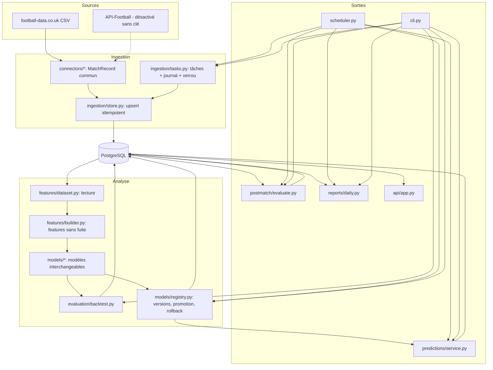

# Architecture

Couches strictement séparées. Chaque couche ne dépend que de celles du dessous.

## Points clés

- **Format commun** : tout connecteur renvoie des `MatchRecord` (`connectors/base.py`).
  Ajouter une source = écrire un connecteur, sans toucher au reste.
- **Idempotence** : un match est identifié par `(source, external_id)` dans
  `match_external_refs`. Les cotes sont uniques par
  `(match, source, bookmaker, marché, sélection, label du relevé)`.
- **Provenance** : `source_id` et `collected_at` sur chaque donnée externe ;
  `captured_at` / `known_at` quand l'heure de connaissance est disponible.
- **Transactions** : une transaction par fichier importé ; un fichier défectueux
  ne laisse aucune ligne partielle.
- **Verrous** : `scheduled_jobs.lock_owner` + expiration, pris par un seul `UPDATE`
  conditionnel. Une tâche planifiée et une tâche manuelle ne se chevauchent pas.
- **Temps** : stockage en UTC ; affichage et planification en `TIMEZONE`
  (Africa/Lubumbashi par défaut).
- **Modèles** : interface `fit / predict` (`models/base.py`), configuration nommée
  dans `models/zoo.py`. Un nom construit toujours la même configuration.
- **Promotion** : critères dans `PromotionCriteria` (config), fixés avant
  l'évaluation. Échec ⇒ le modèle actif reste en place.

## Schéma de données

28 tables (migration `0001`). Tables demandées : `competitions, seasons, teams, players,
matches, match_events, team_match_statistics, player_match_statistics, injuries,
suspensions, lineups, odds_snapshots, news_items, data_sources, collection_runs,
predictions, user_predictions, match_outcomes, model_versions, training_runs,
model_metrics, prediction_evaluations, detected_patterns, scheduled_jobs`.

Tables ajoutées pour la traçabilité : `team_aliases` (noms par source),
`match_external_refs` (identité par source), `competition_source_codes`
(code de la compétition chez chaque source), `data_quality_issues`.

Tables créées mais **encore vides** faute de source : `players`, `player_match_statistics`,
`match_events`, `lineups`, `injuries`, `suspensions`, `news_items`, `detected_patterns`.
Elles seront remplies par API-Football (clé requise) et le moteur de patterns (phase 7).
