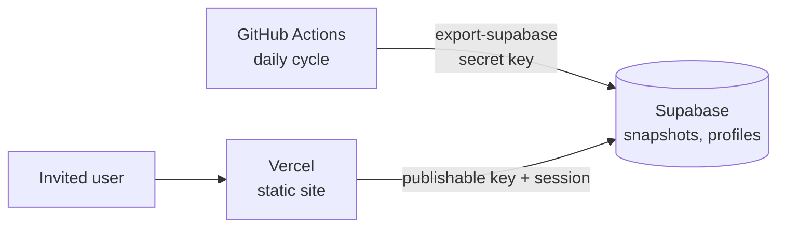

# Private site (Supabase + Vercel)

Decision D57, plan `docs/DEPLOYMENT_PLAN.md` section 10.



- `site.js`: sign-in, account request with an invitation code, accounts page for the
  super admin, data read from the `snapshots` table.
- `build.sh`: copies the dashboard from `src/footintel/api/static` into `dist/` and adds
  the Supabase layer.
- Site: https://benkassiyfootball.vercel.app (Vercel project `benkassiyfootball`).
- `../supabase/migrations/`: tables, row level security, account functions.
- `.github/workflows/util-football-intel-daily.yml`: daily cycle, encrypted state in the
  Actions cache, export to Supabase.

## Deploy a new version of the site

The Vercel project is not linked to GitHub. The scripts and styles come from jsDelivr at
a pushed commit, with integrity hashes. Vercel holds only `index.html`, `value.html`,
`config.js` and `vercel.json`.

1. Commit and push the change.
2. `CDN_COMMIT=$(git rev-parse HEAD) football-intel/web/build.sh`. The script stops if a
   file on jsDelivr differs from the local file.
3. Deploy the four files of `web/dist/` to the Vercel project (production).

Data changes need no deployment: the daily export writes them to Supabase.

## Accounts

| Status | Meaning |
|---|---|
| `en_attente` | Request sent with a valid code; cannot see data |
| `actif` | Approved by the super admin |
| `refuse` / `suspendu` | No access |

The super admin is the account whose e-mail is in `private.settings`
(`superadmin_email`). It is not in this public repository. To change it, run in the
Supabase SQL editor:

```sql
update private.settings set value = 'new@address' where key = 'superadmin_email';
```

Open signup stays off (`open_signup = 'false'`). Only invitation codes work.

## One-time setup (owner)

1. Supabase, Authentication > URL Configuration: set Site URL to
   `https://benkassiyfootball.vercel.app` and add `https://benkassiyfootball.vercel.app/**`
   to Redirect URLs. Without it, confirmation and password links point to localhost.
2. Supabase, Project Settings > API Keys: create a secret key.
3. GitHub, repository Settings > Secrets and variables > Actions:
   - variable `SUPABASE_URL` = `https://mnwyipiakbleihdfpegg.supabase.co`
   - secret `SUPABASE_SECRET_KEY` = the secret key of step 2
   - secret `FOOTINTEL_STATE_KEY` = a long random password (encrypts the cached database;
     keep a copy: without it the state cannot be read)
   - optional secrets: `FOOTBALL_DATA_ORG_KEY`, `ODDS_API_KEY`, `TELEGRAM_BOT_TOKEN`,
     `TELEGRAM_CHAT_ID`
4. Merge the branch into `master`: scheduled workflows run only from the default branch.
   Then start the workflow once by hand (Actions > football-intel > Run workflow).
5. Sign up on the site with the super admin e-mail (no code needed), confirm the e-mail.

## Limits

- Supabase free: 500 MB database, project paused after 7 days without activity (the
  daily export prevents it), a few auth e-mails per hour with the built-in sender.
- Only the default period of each competition is exported; other periods show the
  default one. Personal picks and the local administration page are not on the site.
