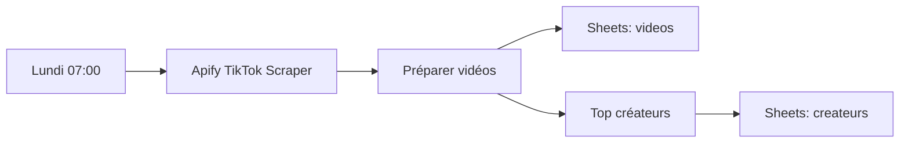

# PitUp – Veille TikTok Lubumbashi

Collecte chaque semaine les vidéos TikTok liées à Lubumbashi avec l'Actor Apify
[`clockworks/tiktok-scraper`](https://apify.com/clockworks/tiktok-scraper), puis
produit deux tableaux :

- **videos** : vidéos des 30 derniers jours (vues, likes, partages, taux d'engagement, lien).
- **createurs** : créateurs classés par vues moyennes → candidats pour des partenariats PitUp.



## Fichiers

| Fichier | Rôle |
|---|---|
| `input.json` | Hashtags et recherches à suivre (source unique) |
| `transform.mjs` | Nettoyage, dédoublonnage, calcul d'engagement, classement créateurs |
| `run.mjs` | Exécution ponctuelle en ligne de commande → `out/*.csv` |
| `build-workflow.mjs` | Régénère `workflow.json` depuis `input.json` + `transform.mjs` |
| `workflow.json` | Workflow n8n à importer |

## 1. Créer le token Apify

1. Créez un compte sur https://console.apify.com.
2. Copiez le token dans **Settings → API & Integrations**.

## 2. Test rapide (terminal)

Depuis `pitup/tiktok-veille/` :

```bash
node run.mjs --dry-run              # affiche le coût max estimé, sans appel
APIFY_TOKEN=xxx node run.mjs        # lance l'Actor (payant), écrit out/videos.csv et out/createurs.csv
```

Passez le token par variable d'environnement, jamais en argument.

## 3. Workflow n8n

1. n8n → **Workflows → Import from File** → `workflow.json`.
2. Nœud **Apify – TikTok Scraper** : créez un credential **Header Auth**
   - Name : `Authorization`
   - Value : `Bearer <votre token>`
3. Nœuds **Google Sheets** : connectez votre compte Google, collez l'URL d'un
   classeur contenant deux onglets `videos` et `createurs` (ligne 1 vide : n8n crée les colonnes).
4. Cliquez **Execute workflow** une fois pour valider, puis activez-le.

Après modification de `input.json` ou `transform.mjs` : `node build-workflow.mjs`, puis réimportez.

## Coût

8 sources × 20 résultats = 160 résultats max par exécution ≈ **0,27 $** au tarif
public (1,70 $ / 1 000 résultats), soit ≈ 1,10 $/mois en hebdomadaire. Les filtres
de date de l'Actor sont facturés en plus : le filtre « 30 jours » est donc fait dans n8n.

## Limites connues

- Les hashtags de `input.json` sont des hypothèses : vérifiez après le 1er run ceux
  qui ne ramènent rien (lignes `⚠` / `errorCode`) et remplacez-les.
- `run-sync` attend au maximum 300 s. Si le volume augmente, passez à un run
  asynchrone (`/runs` puis lecture du dataset).
- Ajoutez les comptes TikTok des concurrents ou boutiques partenaires dans `profiles`.
